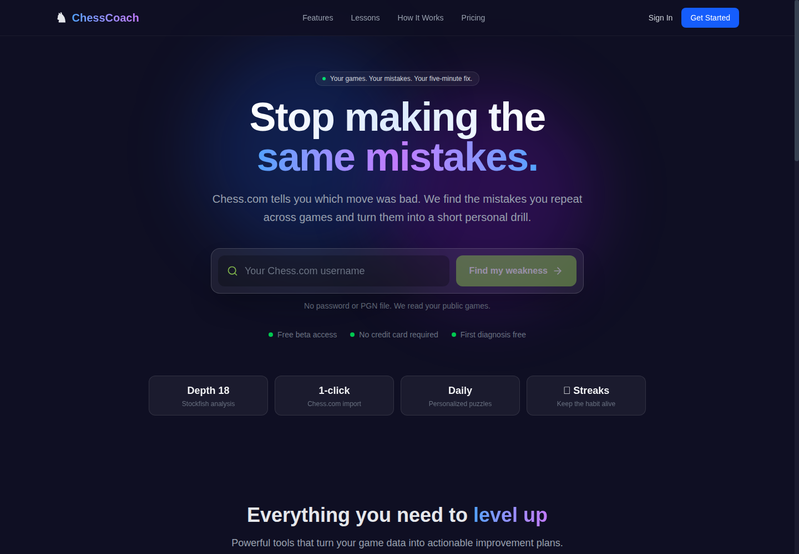
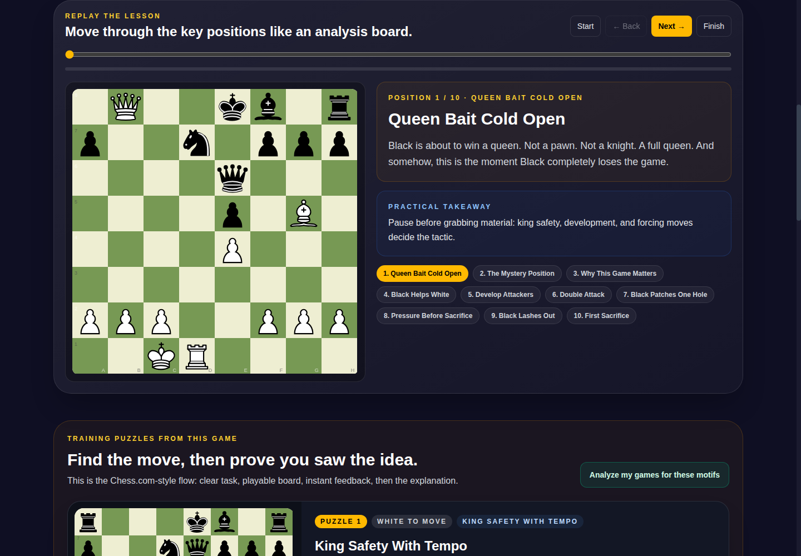

# MyChessCoach

**Retired October 2026 · private source · screenshots from the live application**

## The idea

A game review can tell you which move was bad. The more useful question is: **which mistake do you keep making, and what should you practice next?**

I built MyChessCoach as a personal chess-training app around that loop. Import games from Chess.com or a PGN file, analyze the positions, identify recurring weaknesses, and turn them into short drills drawn from the player's own games. The aim was to make analysis lead to practice, rather than another dashboard to stare at.

## What I built

- **Game import and review:** Chess.com and PGN imports, move-by-move analysis, and game history.
- **Engine-backed analysis:** Stockfish in a browser Web Worker, with move classification and centipawn-loss calculations.
- **Personal training:** pattern detection, puzzles generated from mistakes, opening performance, and progress views.
- **Coaching explanations:** AI-assisted explanations alongside engine analysis, connecting the move to the underlying idea.
- **Interactive lessons:** famous games broken into key positions, tactical motifs, replay controls, and playable puzzles. This also explored a watch → replay → solve path from Blunder Knight videos into practice.

## The lesson experience

Morphy's Opera Game shows the public side of the product: step through the critical positions, read the practical takeaway, then solve related tactics. The board is an interactive interface, not a static illustration.

These desktop screenshots were captured from the deployed application on October 25, 2026, before retirement. They show the public landing page and a historical-game lesson, not private player records or fabricated dashboard results.

[View the mobile lesson screenshot](../assets/chesscoach-mobile.png).

## How it was built

Next.js and TypeScript handled the app and API; PostgreSQL on Neon with Prisma stored games and training state. Stockfish, chess.js, and Chessground covered evaluation, game rules, and board interaction. Privy supplied authentication. The code also included Stripe subscription integration; the final public experience advertised free beta access.

The engineering work crossed several layers: importing and normalizing games, keeping analysis off the main browser thread, mapping evaluations to understandable mistakes, and carrying those mistakes into a practice workflow.

## Why sunset it

I chose to retire the hosted app during an infrastructure cleanup so I could focus on current projects and reduce ongoing maintenance. The source and database were preserved; this page keeps the product story and interface visible without keeping the service running.

The project explored a useful distinction: **an engine evaluation is an answer; a training loop helps someone act on it.** That was the product direction—not a claim of measured rating improvement or commercial traction.

[Back to profile](../README.md)
