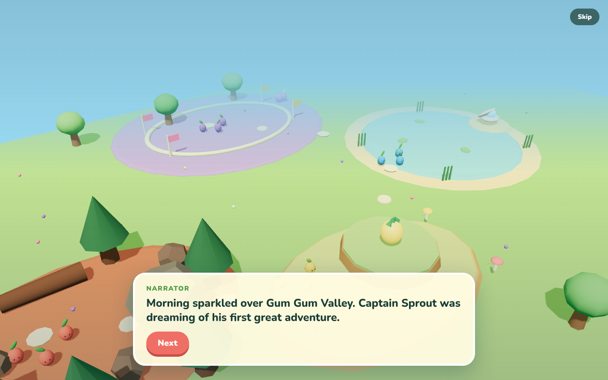

# Gum Gum Valley

A simple, fun 3D browser game I’m building with my five-year-old daughter, loosely inspired by Pikmin.

Lead Captain Sprout and a team of little creatures through a colorful world. Each team has a different ability: pushing rocks, climbing ledges, crossing water, or running fast.

**Playable work in progress · private code**

[Play Gum Gum Valley](https://pikem.taborlin.co/)

## How to play

On a computer, use WASD or the arrow keys to move, Space to whistle, and click to send your team toward an object. The opening story has Next and Skip controls.

## Built with

JavaScript, Three.js, and Vite. Procedural 3D scenery, specialized creature behaviors, guided missions, story scenes, and synthesized sound.
