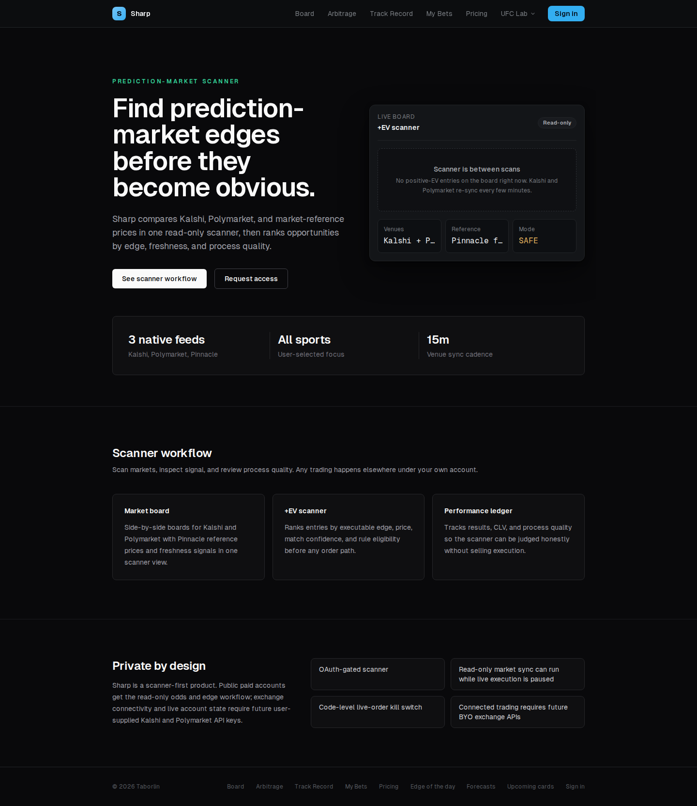

# Sharp

**Retired September 2026 · private source · historical screenshot**

## The product

A prediction-market research application for comparing feeds, ranking potential edges, and examining market signals.

## What I built

- Feed ingestion and comparison across market venues and reference prices.
- Edge-ranking, freshness checks, and cross-market research views.
- A Next.js frontend and FastAPI backend.
- Separate operator execution and risk-control code, kept apart from the public research interface.

## Preserved interface

Captured September 13, 2026 from a local frontend with no live backend. The image shows the interface, not live prices, trading performance, or a working execution service.

The hosted product was retired for cost control. Source remains private. No trading system needs to be restarted to inspect this portfolio entry.

[Back to profile](../README.md)
