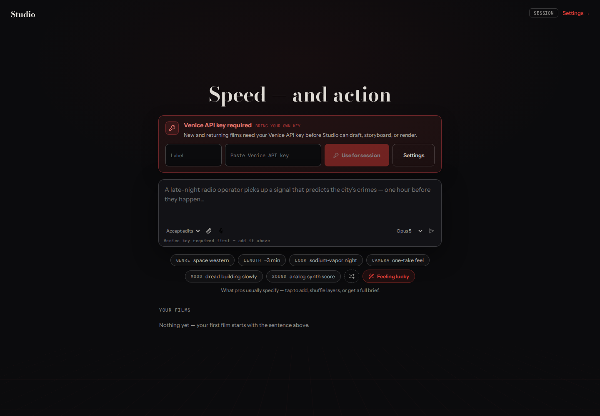

# Studio

**Retired September 2026 · private source · historical screenshot**

## The product

An AI-assisted filmmaking workspace connecting film ideas, shot planning, 3D blocking, and generation workflows.

## What I built

Built on Emulsion’s scene-blocking foundation. I added film and project planning, model-provider integrations, take generation, and production-job handling.

- Structured film briefs, scenes, cast references, and shot specifications.
- Browser-based three.js scene blocking and export.
- Bring-your-own-key model/generation workflows.
- Project/media storage and worker-driven render/assembly paths.

[Related public Emulsion fork](https://github.com/0xatd/emulsionfork1)

## Screenshot

Start screen, September 2026, before the service was retired.

[Back to profile](../README.md)
